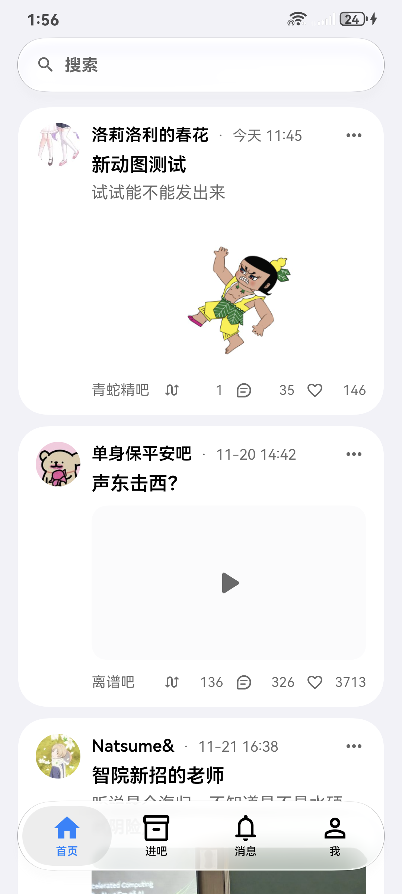
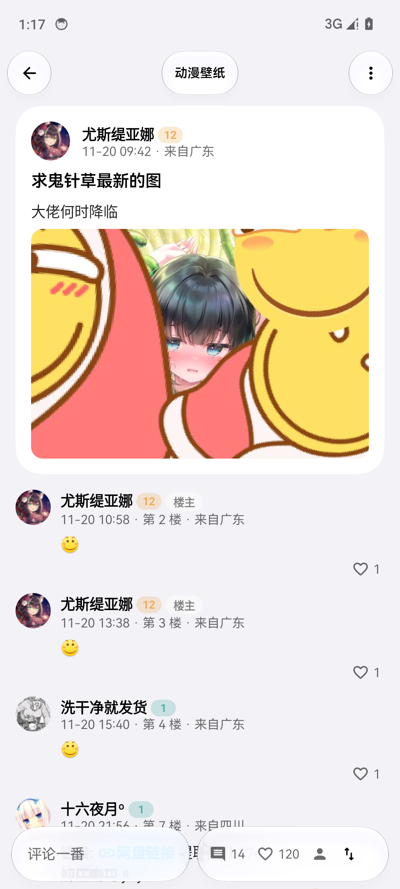
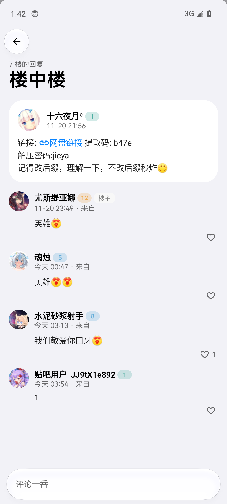
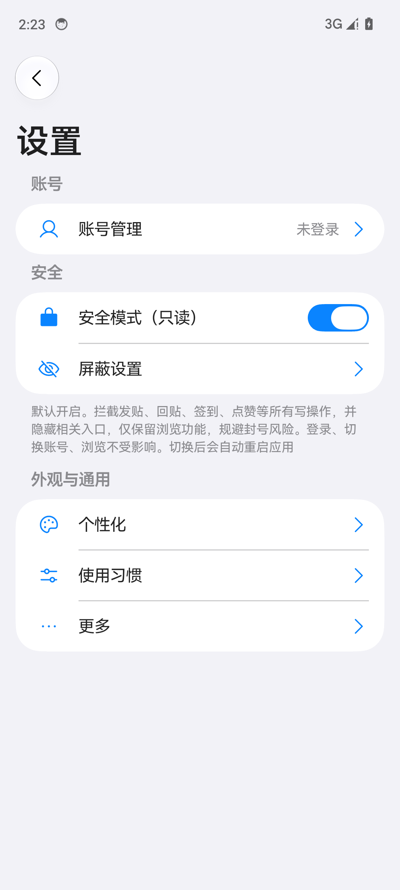
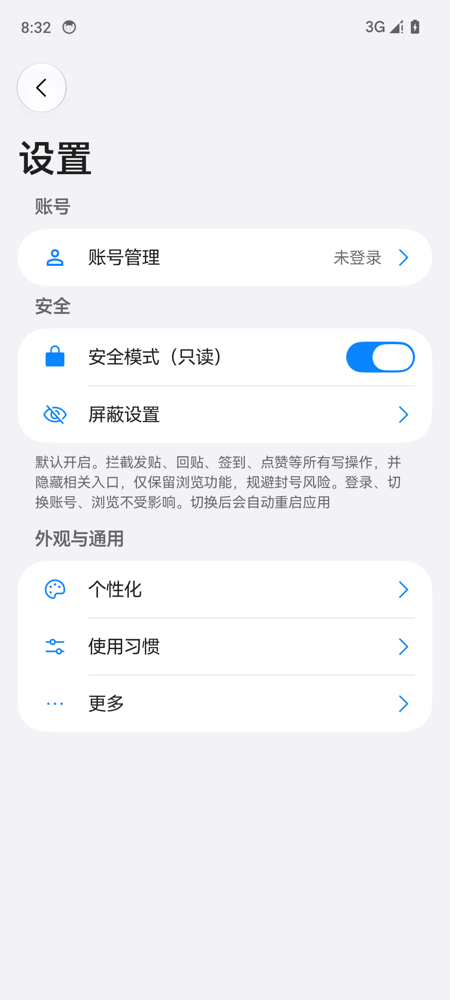
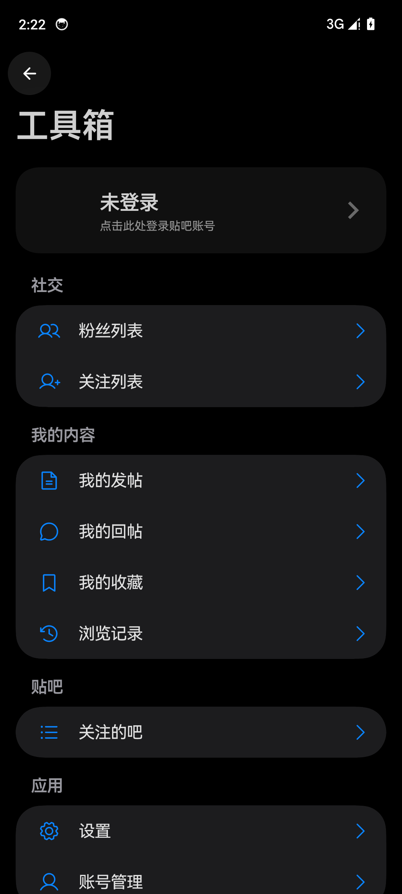

<div align="center">

# Tiebaliquid

**一个液态玻璃风格（iOS 26/27 观感）的第三方百度贴吧 Android 客户端**

基于 [TiebaLite](https://github.com/HuanCheng65/TiebaLite) 4.0-dev 血脉，
经 [Aur5411/TiebaApp](https://github.com/Aur5411/TiebaApp)（Material 3 重制）二次开发，
本分支把**表现层**重写为基于 [Glasmio](https://github.com/neoruaa/Glasmio) 的液态玻璃视觉。

[](./LICENSE)


[下载最新版本](../../releases/latest) · [问题反馈](../../issues)

</div>

---

## 截图

| 首页 | 帖子详情 |
| :---: | :---: |
|  |  |

| 楼中楼 | 设置 |
| :---: | :---: |
|  |  |

| 图标与排版 | 深色（AMOLED） |
| :---: | :---: |
|  |  |

## 特点

- **液态玻璃材质**：底栏、顶栏、底栏、菜单、弹窗全部走 Glasmio 的 `RuntimeShader` 玻璃（背景采样 → 模糊 → 折射/边缘高光）
- **iOS 式页面语言**：一级页面无标题栏、大标题随滚动收起；二级页大标题 + 悬浮返回圆钮
- **卡片化的信息流**：头像 / 标题 / 正文 / 图片 / 吧名与互动数据，连续大圆角
- **平面化楼层**：主楼为卡片，楼层为无分割线的平面行，楼中楼为圆角预览块
- **统一的字形与图标**：HarmonyOS Sans SC 子集；Phosphor Icons（MIT）替换 Material 图标
- **单一主题令牌**：颜色 / 圆角 / 字号全部来自 `AppTokens`，浅色与 AMOLED 深色两套
- **菜单 source-transfer 形变**：菜单从触发器位置生长而出，而不是从中心缩放

## 与上游的关系

```
百度贴吧（官方，闭源）
   └── TiebaLite（HuanCheng65，GPL-3.0，已归档）
          └── TiebaApp（Aur5411，GPL-3.0，Material 3 重制，包名改为 com.tieba）
                 └── Tiebaliquid（本项目，表现层重写为液态玻璃）
```

- **业务层**（贴吧 API、protobuf、Room、登录、ViewModel）继承自上游，未做修改
- **表现层**（主题、组件、图标、字体、页面骨架）在本分支重写
- 包名 `com.tieba`，可覆盖安装 Aur5411 的 TiebaApp；与 TiebaLite（`com.huanchengfly.tieba.post`）是两个独立 App，数据不互通

## 构建

需要 JDK 21、Android SDK 36。构建环境与依赖版本（重要，组合较新）：

| 项 | 版本 |
| --- | --- |
| Gradle | 8.14.5 |
| AGP | 8.13.2 |
| Kotlin | 2.4.21 |
| Compose BOM | 2026.09.00 |
| compileSdk / targetSdk / minSdk | 36 / 36 / 33 |

```bash
./gradlew :app:assembleDebug
```

Glasmio 的几个模块以本地 Maven 仓库形式随仓库提供（`libs/maven/`），因此构建**不依赖该库在线可用**。

发布构建需要自备签名（`keystore.properties` 不入库）：

```properties
keystore.file=../path/to/your.jks
keystore.password=******
keystore.key.alias=******
keystore.key.password=******
```

## 已知限制

- **minSdk 33**：液态玻璃依赖 Android 13 的 `RuntimeShader`，Android 12 及以下无法安装
- **部分页面仍为 Material 3 外观**：长尾二级页（屏蔽词、收藏、关注列表等）尚未迁移；`FeedCard` 与 `PostCard` 两套卡片并存
- **部分玻璃为“自采样”**：页面内容层内的悬浮钮采样的是纯色而非真实背景（观感为半透明 + 描边）
- **dock 偶发停帧**：极低概率出现镜头停在中间，未定位（需要真机手势复现）
- **未登录场景未验证**：发帖、编辑资料保存、楼中楼发送等流程需要账号，尚未实测

## 致谢与许可

本项目遵循 **GPL-3.0**，与上游保持一致。

- 业务层与页面结构来自 [HuanCheng65/TiebaLite](https://github.com/HuanCheng65/TiebaLite) 与 [Aur5411/TiebaApp](https://github.com/Aur5411/TiebaApp)
- 液态玻璃渲染来自 [Glasmio](https://github.com/neoruaa/Glasmio)（Apache-2.0），其 AAR 与许可随仓库提供于 `libs/maven/`
- 图标来自 [Phosphor Icons](https://phosphoricons.com/)（MIT）
- 字体为 HarmonyOS Sans SC 子集（免费商用）
- 设计语言参考 [FlClash](https://github.com/chen08209/FlClash) 的 prism_ui 与 Apple Liquid Glass

## 免责声明

本项目为个人学习与技术研究用途，与百度公司无关。请遵守当地法律法规与贴吧用户协议，使用风险自负。
